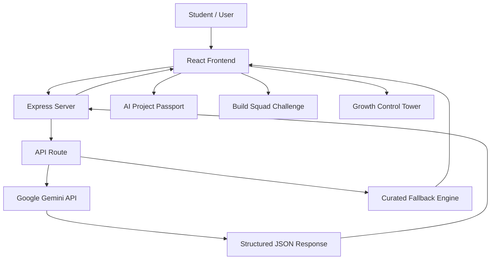
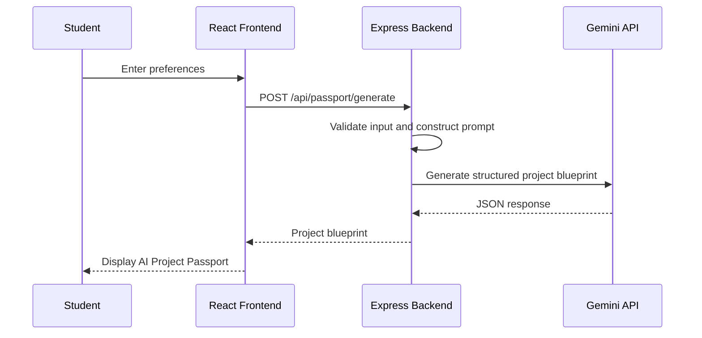

# 🚀 ProjectSpark – Your First AI Project Starts Here

**An AI-powered student engagement and growth platform designed to make workshop discovery, project exploration, and peer-driven participation more engaging.**

ProjectSpark is developed as a solution for the NxtWave Growth Intern Challenge, focused on acquiring **500 final-year engineering student registrations in 7 days with a budget of ₹2,000** for the free workshop *Build Your First AI Project in 60 Minutes*.

🔗 **Live Demo:** https://projectspark.ai.studio

---

## 📌 Problem Statement

Traditional workshop registration campaigns often rely on static landing pages, registration forms, and paid advertisements. These approaches focus primarily on collecting registrations rather than providing immediate value to students or encouraging organic participation.

For final-year engineering students, discovering practical AI project ideas and understanding how to get started can be challenging.

The challenge was to design a growth-oriented solution that:

- Attracts students through meaningful value.
- Encourages organic sharing and peer participation.
- Reduces dependence on paid promotions.
- Provides visibility into campaign performance.
- Works within a limited budget and timeline.

## 💡 Proposed Solution

**ProjectSpark transforms workshop discovery into an interactive experience.**

Instead of simply asking students to register, it provides personalized AI project ideas, encourages students to invite their peers, and offers a centralized dashboard to understand and monitor campaign performance.

The platform is built around three core modules:

## ✨ Key Features

### 1. AI Project Passport

Helps students discover personalized AI project ideas based on their academic background and interests.

**Features:**
- Personalized project idea generation using Google Gemini.
- Student inputs based on academic branch, experience level, and preferred AI domain.
- Project title, problem statement, solution description, and suggested features.
- Recommended technology stack and workshop build scope.
- Placement relevance and STAR-format resume bullet points.
- Copy and share functionality for generated project ideas.
- Curated fallback suggestions when AI generation is unavailable.

### 2. Build Squad Challenge

Encourages students to participate and invite their classmates through a peer-driven referral mechanism.

**Features:**
- Unique squad codes and referral links.
- Invitation messages that can be customized.
- WhatsApp sharing support.
- Peer invitation and squad-building experience.
- Referral activity log.
- Simulated referral activity to demonstrate attribution and engagement.

The concept encourages students to involve their classmates and build a community around the workshop.

### 3. Growth Control Tower

A centralized dashboard designed to monitor and analyze the proposed seven-day growth campaign.

**Features:**
- Registration progress against the 500-student target.
- Remaining registrations and campaign progress.
- Budget utilization and cost-per-registration metrics.
- Channel-wise performance analysis.
- Registration trend visualization.
- Referral contribution breakdown.
- Seven-day campaign timeline.
- Growth recommendations with interactive simulations.

**Note:** Dashboard figures and baseline campaign metrics are illustrative/simulated data. Interactive calculations demonstrate how campaign decisions could influence projected performance; they should not be interpreted as actual campaign results.

---

## 🔄 Growth Workflow

ProjectSpark follows a connected growth journey:

1. **Discover:** Students explore the platform and personalized AI project ideas.
2. **Register:** Students are directed towards the workshop registration journey.
3. **Invite:** Students share invitations with classmates through the Build Squad experience.
4. **Measure:** Campaign performance and channel contributions are represented in the Growth Control Tower.
5. **Optimize:** Growth recommendations help evaluate possible improvements to the campaign.

---

## 🛠️ Technology Stack

| Category | Technologies |
|---|---|
| Frontend | React 19, TypeScript |
| Build Tool | Vite |
| Styling | Tailwind CSS v4 |
| Backend | Node.js, Express.js |
| AI Integration | Google Gemini API |
| AI SDK | Google Gen AI SDK (`@google/genai`) |
| Icons | Lucide React |
| Animations | Canvas Confetti |
| Environment Management | dotenv |
| Development Runtime | TSX |

### Why These Technologies?

- **React:** Builds a reusable, component-based user interface.
- **TypeScript:** Provides type safety and structured data models.
- **Vite:** Supports fast development and optimized production builds.
- **Tailwind CSS:** Enables consistent and responsive UI styling.
- **Node.js and Express:** Handle backend API requests and server-side operations.
- **Google Gemini:** Generates personalized AI project blueprints.
- **Lucide React:** Provides lightweight interface icons.

---

## 🏗️ System Architecture

ProjectSpark follows a unified full-stack architecture using a React frontend and an Express backend.

The Express server handles API requests and serves the frontend application. The Gemini API is accessed through the backend to keep the API key away from client-side code.

### Architecture Overview



### AI Project Generation Flow



If the Gemini API is unavailable or the API key is missing, the backend uses curated project suggestions as a fallback.

---

## 🤖 AI Integration

ProjectSpark integrates Google's Gemini model using the official `@google/genai` TypeScript SDK.

The AI integration is primarily used in the AI Project Passport module.

**How it works:**

1. The student provides their name, academic branch, experience level, and preferred AI domain.
2. The frontend sends the information to the backend.
3. Express constructs the prompt and sends the request to Gemini.
4. Gemini generates a structured project blueprint.
5. The backend returns the response to the frontend.
6. React displays the generated project details in the AI Project Passport.

Structured JSON output is used to maintain consistency in the generated project information.

A curated fallback engine is also available to keep the experience functional when live AI generation cannot be completed.

---

## 📂 Project Structure

```text
ProjectSpark/
│
├── server.ts
├── index.html
├── package.json
├── metadata.json
├── tsconfig.json
├── vite.config.ts
│
└── src/
    ├── main.tsx
    ├── App.tsx
    ├── index.css
    ├── types.ts
    │
    ├── data/
    │   └── mockData.ts
    │
    └── components/
        ├── Navbar.tsx
        ├── WorkshopHub.tsx
        ├── GrowthJourney.tsx
        ├── ProjectPassport.tsx
        ├── BuildSquad.tsx
        └── GrowthTower.tsx
```

### Important Files

| File | Responsibility |
|---|---|
| `server.ts` | Express server, Gemini integration, API routes, and Vite middleware |
| `App.tsx` | Main application container, navigation, and shared state |
| `ProjectPassport.tsx` | AI project generation interface |
| `BuildSquad.tsx` | Referral and peer invitation functionality |
| `GrowthTower.tsx` | Campaign analytics dashboard |
| `WorkshopHub.tsx` | Homepage and feature overview |
| `GrowthJourney.tsx` | Growth workflow visualization |
| `types.ts` | Shared TypeScript interfaces and data types |
| `mockData.ts` | Sample campaign and dashboard data |
| `vite.config.ts` | Vite configuration |

---

## ⚙️ Getting Started

Follow these steps to run ProjectSpark locally.

### Prerequisites

Make sure you have installed:

- Node.js 20.x or higher
- npm 10.x or higher
- Git (if cloning the repository)

### 1. Clone the Repository

```bash
git clone <YOUR_GITHUB_REPOSITORY_URL>
```

Navigate to the project directory:

```bash
cd ProjectSpark
```

### 2. Install Dependencies

```bash
npm install
```

### 3. Configure Environment Variables

Create a `.env` file in the project root directory.

```env
PORT=3000
GEMINI_API_KEY=your_gemini_api_key
```

Obtain your Gemini API key from:

https://aistudio.google.com/apikey

**Important:** Keep your API key private. Never commit your `.env` file to GitHub.

### 4. Run the Development Server

```bash
npm run dev
```

Open your browser and navigate to:

```text
http://localhost:3000
```

### 5. Verify the Backend

The application provides a health-check endpoint:

```bash
curl http://localhost:3000/api/health
```

A successful response should indicate that the server is running and report whether the Gemini API key is configured.

---

## 🚀 Deployment

ProjectSpark is configured for a Node.js production environment and is designed to run in a containerized Google Cloud Run environment.

### Build the Application

```bash
npm run build
```

This generates optimized frontend assets in the `dist/` directory.

### Start the Production Server

```bash
npm run start
```

The Express server serves the production frontend assets and handles backend API requests.

### Deployment Considerations

- Configure `GEMINI_API_KEY` as a secure environment variable in the hosting platform.
- Ensure the application listens on the port provided by the hosting environment.
- Do not expose API credentials in frontend code.
- Verify the health endpoint after deployment.
- Test AI generation and fallback functionality in the deployed environment.

---

## 🔮 Future Scope

ProjectSpark can be extended with additional capabilities:

- **60-Second AI Challenge:** A quick interactive experience to introduce students to AI project ideas.
- **Campus Momentum Map:** Visualize engagement and registration performance across participating campuses.
- **Real-Time Campaign Analytics:** Integrate actual registration and marketing data.
- **Advanced Referral Tracking:** Implement reliable referral attribution and conversion tracking.
- **Student Authentication:** Introduce user accounts and saved project ideas.
- **AI Project Refinement:** Allow students to modify generated ideas and explore implementation guidance.

---

## ⚠️ Current Limitations

- Campaign analytics currently use illustrative/simulated baseline data rather than verified live campaign results.
- Referral activity simulation demonstrates the intended workflow but is not equivalent to production-grade referral attribution.
- Authentication and persistent student accounts are not implemented as a complete production system.
- Real-world campaign performance and registration conversion rates require validation through actual student participation.

---

## 🎯 Project Objective

ProjectSpark demonstrates how AI-powered personalization, peer-driven engagement, and data-informed growth planning can be combined into a single platform.

The goal is to move beyond traditional workshop promotion and create a more engaging experience for students while giving campaign organizers a structured way to understand and improve growth performance.

---

## 👩‍💻 Author

**Karanam Charvi**

B.Tech – Computer Science and Engineering

---

*Built as part of the NxtWave Growth Intern Challenge.*
